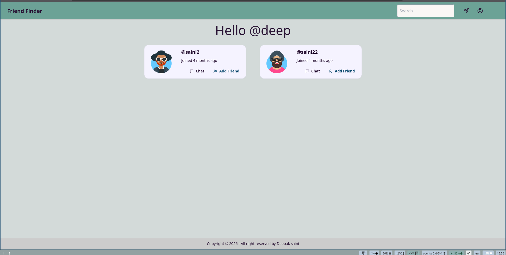
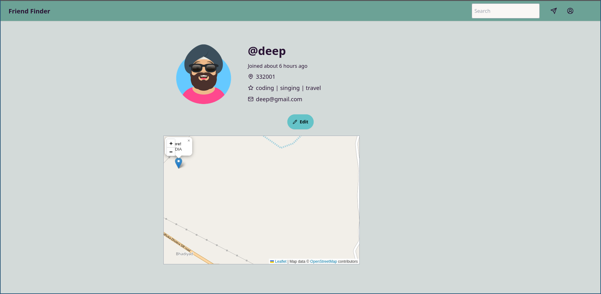
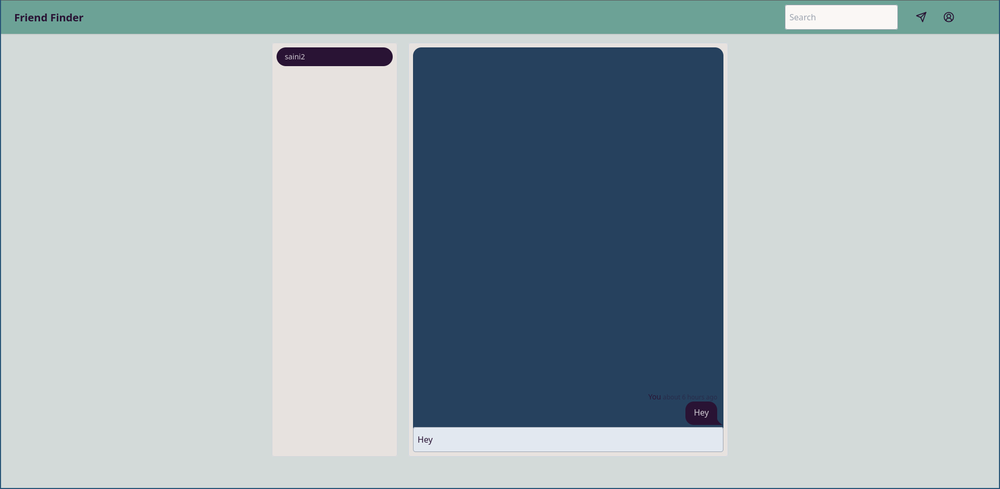

# Friend Finder

A full-stack social app to discover and chat with new friends, searchable by **username, topic, or pincode**, with users shown on a live street map.


### 👉 [**Live Demo**](https://friends.new.nkit.dev/login)

## 📸 Screenshots

| Login | Home |
|:---:|:---:|
|  |  |

| Profile | Chat |
|:---:|:---:|
|  |  |


## ✨ Features

- **Auth**: registration and login with secure, HTTP-only cookie sessions
- **Chat**: one-to-one messaging between users
- **Search**: find people by username, topic, or pincode
- **Map**: your location and other users' markers on a Leaflet street map, using the browser Geolocation API
- **Deployment**: one-command setup with Docker Compose

## 🧱 Tech Stack

| Layer | Tech | Role |
|---|---|---|
| Frontend | SvelteKit, Tailwind CSS | UI, routing, responsive layout |
| Backend | FastAPI (Python) | REST API, auth, search, chat |
| Database | SQLite | Users, profiles, messages |
| Maps | Leaflet.js | Street map and user markers |
| Deployment | Docker, Docker Compose | Containerized frontend and backend |

## 🏗️ How It Works

```
SvelteKit (UI)  ──HTTP──▶  FastAPI (API)  ──▶  SQLite
      ▲                          │
      └── session cookie ◀───────┘
```

- On login, the backend sets a session token in an HTTP-only cookie. Every later request is authorized with it.
- Search queries hit FastAPI endpoints that filter users by username, topic, or pincode.
- The frontend reads the browser's coordinates and renders users as markers with Leaflet.

## 🚀 Getting Started

**Prerequisites:** Docker, or Python 3.10+ and Node.js 18+.

```bash
git clone https://github.com/your-username/friend-finder.git
cd friend-finder
```

### Option 1: Docker (recommended)

```bash
docker-compose up --build
```

### Option 2: Run manually

**Backend**

```bash
cd backend
python -m venv venv
source venv/bin/activate        # Windows: venv\Scripts\activate
pip install -r requirements.txt
uvicorn main:app --reload
```

**Frontend**

```bash
cd frontend
npm install
npm run dev
```

## 📁 Project Structure

```
friend-finder/
├── backend/
│   ├── main.py
│   ├── models/
│   └── routes/
├── frontend/
│   └── src/
│       └── routes/
├── docs/screenshots/
├── docker-compose.yml
└── README.md
```

## 🛣️ Roadmap

- [ ] Notifications
- [ ] Friend request system
- [ ] File and image sharing in chat
- [ ] UI enhancements
- [ ] PostgreSQL support

## 👤 Author

**Deepak Kumar Saini**
[GitHub](https://github.com/Deepaksaini00) · [LinkedIn](www.linkedin.com/in/deepak-saini-07d02) ·deepaksaini062005@example.com


# Friend Finder Web Application

**Friend Finder** is a full-stack social web application where users can connect, chat, and discover new friends by searching based on username, topic, or pincode.

## 🚀 Tech Stack

- **Frontend**: [SvelteKit](https://kit.svelte.dev/) + [Tailwind CSS](https://tailwindcss.com/)
- **Backend**: [FastAPI](https://fastapi.tiangolo.com/)
- **Database**: SQLite
- **Authentication**: Session tokens stored in cookies
- **Deployment**: Docker
- **Maps**: [Leaflet.js](https://leafletjs.com/) for displaying user locations on a street map

## 🌟 Features

- 🧑‍🤝‍🧑 User registration and login
- 🔐 Secure session-based authentication
- 💬 Real-time chat functionality
- 🕵️‍♂️ Search friends by username, topic, or pincode
- 🗺️ User map integration
- 🗺️ Map integration using Leaflet.js** to show nearby or connected users on a street-level map
- 📦 Easy to deploy with Docker

## 🧭 Interactive Map with Leaflet.js

Friend Finder uses **Leaflet.js** to embed a real-time street map (StreetFit style) where users can:

- View their own location on the map
- See other users' locations
- Explore and interact with user markers

The map is lightweight, mobile-friendly, and integrated with the Geolocation API to fetch current coordinates securely.

## 🧑‍💻 Getting Started

### Prerequisites

- Python 3.10+
- Node.js 18+
- Docker (for containerized deployment)

### 1. Clone the repository

```bash
git clone https://github.com/your-username/friend-finder.git
cd friend-finder


** Set up the backend (FastAPI)

- cd backend
- python -m venv venv
- source venv/bin/activate
- pip install -r requirements.txt
- uvicorn main:app --reload


** Set up the frontend (SvelteKit)

- cd frontend
- npm install
- npm run dev

** Run with Docker

- docker-compose up --build

📁 Project Structure

friend-finder/
├── backend/
│   ├── main.py
│   ├── models/
│   ├── routes/
│   └── ...
├── frontend/
│   ├── src/
│   ├── routes/
│   └── ...
├── docker-compose.yml
└── README.md

🔒 Authentication

Session-based authentication using secure HTTP-only cookies. Tokens are set upon successful login and are used to authorize subsequent requests.


📌 Future Improvements

    Notifications system

    Friend request mechanism

    File/image sharing in chat

    UI enhancements

    PostgreSQL support
